<div align="center">


# NeoDM

**A free, open source download manager for Windows.**

Segmented HTTP/HTTPS downloads, torrents and magnet links, and a browser extension for Chrome, Edge and Brave.

[](https://github.com/unlimitedera/NeoDM/releases/latest)
[](LICENSE)
[](#installation)
[](https://dotnet.microsoft.com/)
[](https://github.com/unlimitedera/NeoDM/releases)

[**Download**](https://github.com/unlimitedera/NeoDM/releases/latest) · [Features](#features) · [Install](#installation) · [Browser extension](#step-2-install-the-browser-extension) · [Extension install guide](docs/EXTENSION-INSTALL.md) · [Build](#building-from-source) · [Changelog](CHANGELOG.md)

<br>

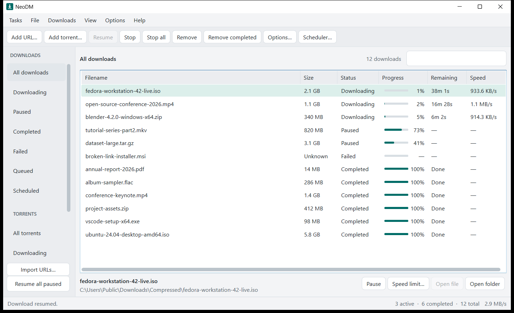

</div>

---

## Overview

- Splits one file across up to 32 connections and gives idle connections new work as others finish.
- Saves resume state, so pause and resume work after a restart. If the file changes on the server, the download restarts instead of being corrupted.
- Handles HTTP/HTTPS downloads, torrents and magnet links, with proxy support, scheduling and speed limits.
- Includes an extension for Chrome, Edge and Brave that catches browser downloads and detects direct video and audio files.
- MIT licensed. No accounts, telemetry, licence checks or ads.
- Runs in the system tray, starts with Windows and can update itself after you confirm.

NeoDM is an open source project created by unlimitedera.

---

## Screenshots

| | |
|---|---|
|  | 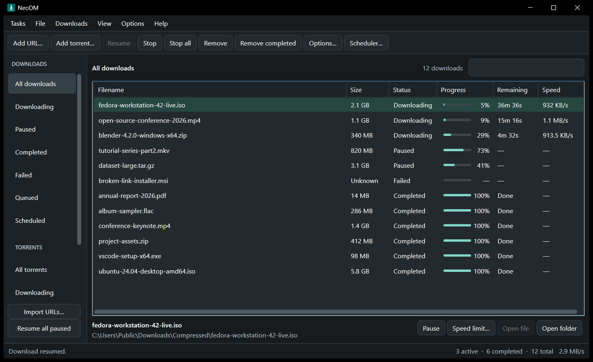 |
| Main window (light) | Main window (dark) |
| 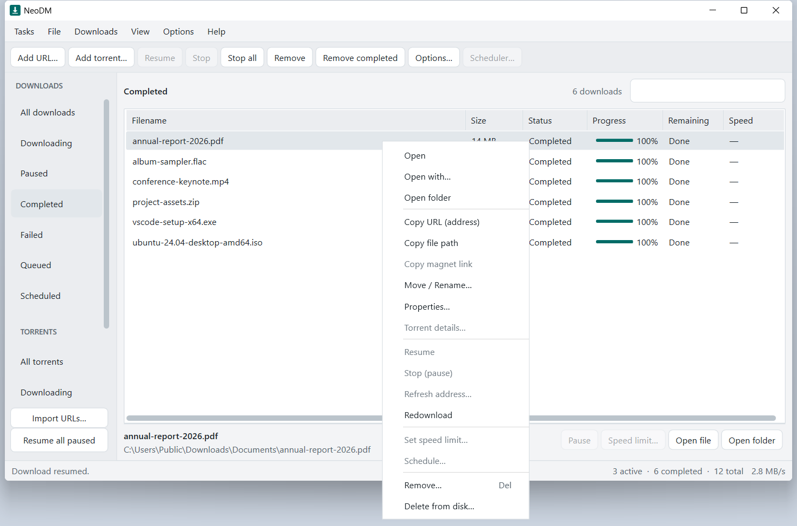 | 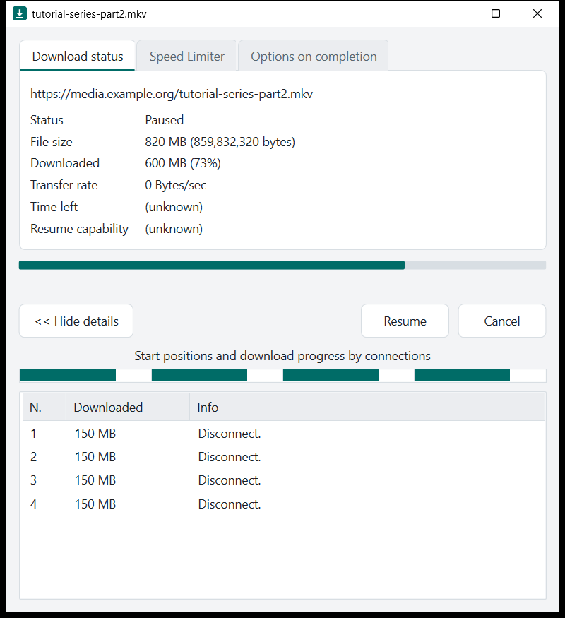 |
| Right-click menu on a download | Per-download progress window |
| 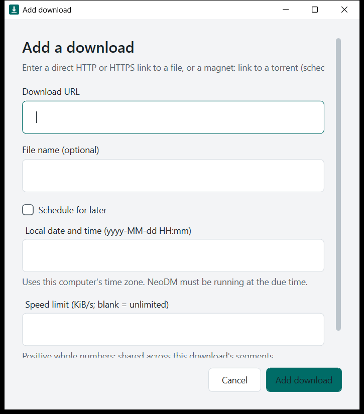 | 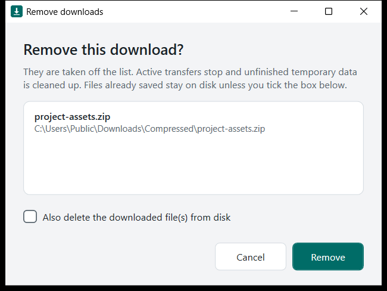 |
| Add a download (schedule, speed limit) | Remove dialog with optional file deletion |
| 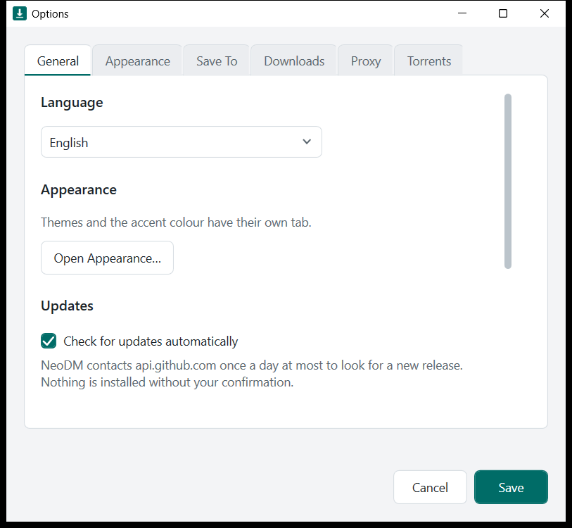 | 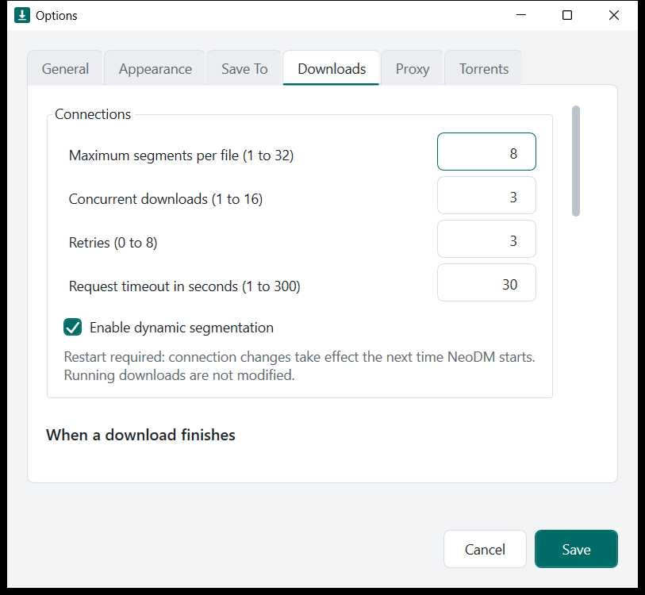 |
| Options: General | Options: Downloads and connections |
| 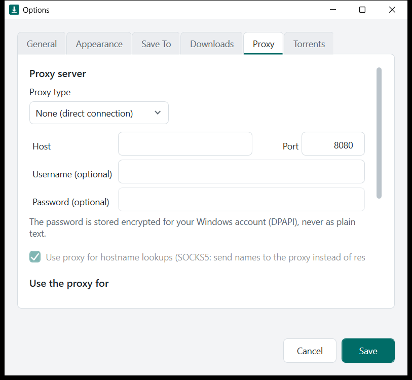 | 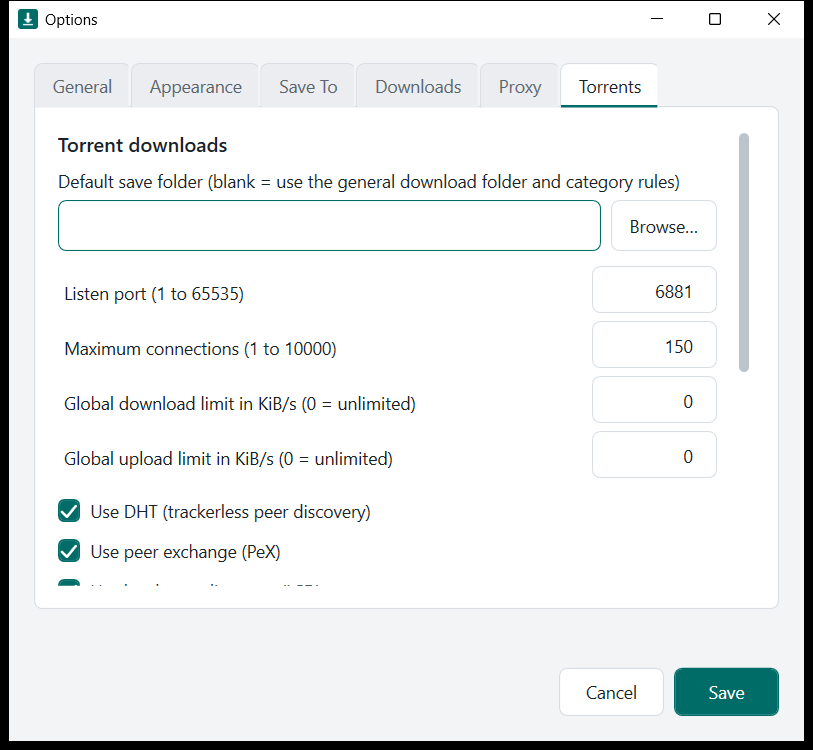 |
| Options: Proxy | Options: Torrents |
| 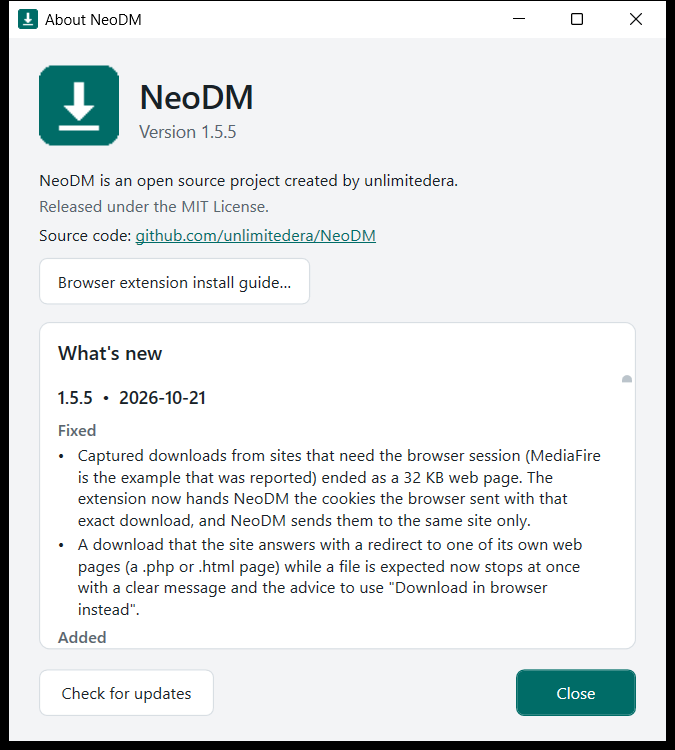 | |
| About window with version and changelog | |

---

## Themes

Pick a theme in Options, Appearance: Light, Dark, System (follows Windows), Midnight, Graphite, Ocean, Forest, Rose or Paper. A theme applies to every window at once, and you can set your own accent colour.

| | | |
|---|---|---|
|  |  |  |
| Midnight | Ocean | Forest |
|  |  |  |
| Rose | Graphite | Paper |

## Features

### Download engine
- Segmented downloading: one file is split across several connections (1 to 32) to use more of your bandwidth.
- Dynamic segmentation: when a connection finishes early, the largest remaining part is split so idle connections keep working.
- Safe resume: pause and resume survive restarts. The file is validated against the server's identifiers, and a changed file restarts safely instead of being corrupted.
- Automatic fallback to a single stream for servers that do not support ranges.
- Smoothed speed, time remaining, resume capability and live per-connection telemetry.
- Retries, request timeouts, and a persistent queue that survives restarts.
- Concurrent downloads limit (1 to 16), per-download and per-job speed limits, and scheduling for a later time.
- File names: unsafe characters are replaced, and a name collision never overwrites an existing file.

### Interface
- Nine themes in Options > Appearance, shown as a gallery with live swatches and an instant preview: Light, Dark, System (follows Windows), Midnight, Graphite, Ocean, Forest, Rose and Paper. You can also set a custom accent colour. Screenshots are in `docs/images/themes`.
- Compact menus and toolbar, sortable download list, and a sidebar with filters (All, Downloading, Paused, Completed, Failed, Queued, Scheduled).
- A separate Torrents section (All torrents, Downloading, Seeding, Completed).
- Search, bulk URL import, Pause all / Resume all, Remove completed.
- Per-download progress window with three tabs: Download status, Speed Limiter and Options on completion. It shows the URL, status, size, downloaded, transfer rate, time left, resume capability and a per-connection table.
- Download complete dialog with Open, Open folder and Close.
- System tray icon. Closing the window keeps NeoDM running in the background. NeoDM starts with Windows, and you can exit it from the tray menu.

### File management
- Right-click menu on downloads: Open, Open with, Open folder, Copy URL, Copy file path, Move / Rename, Properties, Resume, Stop, Refresh address, Redownload, Set speed limit, Schedule, Remove, Delete from disk.
- Remove dialog with an optional checkbox to also delete the downloaded files from disk, or keep them.
- Category folders (on by default): downloads go into Programs, Compressed, Music, Video and Documents subfolders of your Downloads folder, and you can change each location.

### When downloads finish
- Per-download options on completion: show the complete dialog, exit NeoDM, or turn off the computer (shut down, restart, sleep, hibernate, lock, with an optional force flag).
- Global completion actions, including playing a sound, opening the folder, running a program, and power actions.
- Every power action shows a countdown with a Cancel button first.

### Browser integration (Chrome, Edge, Brave)
- Capture downloads started in the browser and send them to NeoDM.
- When a download is captured, a dialog lets you choose Start now, Add to queue or Schedule. It shows where the file will be saved and lets you change the folder. The progress window then stays open until you close or minimise it.
- Media ribbon on video and audio pages that offers to download the media it detects (direct media files; protected or segmented streams are not supported).
- Right-click menu entries to download links and media with NeoDM.
- Talks to the app through a native messaging host over a pipe that only your Windows account can use.
- The extension is Manifest V3 and keeps the same extension ID in every build.

### Torrents
- Magnet links and `.torrent` files, with a file-selection dialog (per-file and per-folder checkboxes, Select all / Select none).
- Seeding, ratio, peers and seeds, per-file priorities, pause and resume, and a details window.
- Options: listening port, DHT, peer exchange, local peer discovery, UPnP / NAT-PMP, encryption, rate limits and connection limits.
- NeoDM registers itself as an available handler for `magnet:` links and `.torrent` files.
- Built on the MIT-licensed MonoTorrent library.

### Proxy
- None, HTTP, HTTPS or SOCKS5, with optional username and password.
- The password is stored encrypted for your Windows account (DPAPI), never as plain text.
- Test connection button, and separate scopes for HTTP/HTTPS downloads and torrent traffic.
- Limits: torrent DHT, local peer discovery, UPnP and UDP trackers are not sent through a proxy. They are switched off while a proxy is active, and incoming torrent connections stay direct.

### Installer
- Windows Installer package (`.msi`) with the NeoDM icon, a Start Menu shortcut and an optional desktop shortcut.
- Starts NeoDM when setup finishes and at every Windows start.
- Upgrades an existing installation in place and keeps your settings and queue. It closes a running NeoDM first.
- Registers the native messaging host for Chrome, Edge and Brave.
- Always puts the extension files (`NeoDM.crx` and an unpacked copy) in the install folder.
- Has an optional browser policy install. It only works on managed PCs. See the browser notes below.

---

## Installation

### Requirements
- Windows 10 or 11, 64-bit.
- Administrator rights for the installer, which installs to Program Files.
- Nothing else. The .NET runtime is bundled.

### Step 1: Install NeoDM
1. Download `NeoDM-Setup-1.4.4.msi` from the [latest release](https://github.com/unlimitedera/NeoDM/releases/latest).
2. Double-click it and follow the wizard: Welcome, license, install folder (default `C:\Program Files\NeoDM`), then the **Browser extension** page.
3. On the **Browser extension** page, leave "Also install through browser policy" unchecked unless you manage your PCs with browser policies. On a normal PC the browsers block that route (see the extension section below).
4. Click Install and accept the Windows permission prompt. NeoDM starts when setup finishes and appears in the system tray.

The installer copies the app, registers the native messaging host for Chrome, Edge and Brave, adds NeoDM to Windows startup, creates a Start Menu shortcut (and an optional desktop shortcut) and puts the browser extension files in `C:\Program Files\NeoDM\extension`.

To update, run the newer installer over the old one. It upgrades in place, closes a running NeoDM, keeps your settings and queue, and starts the new version. It refuses to install an older version over a newer one.

Silent install:

```
msiexec /i NeoDM-Setup-1.4.4.msi /qn
```

Optional properties: `INSTALLFOLDER="D:\NeoDM"`, `RUN_AT_STARTUP=0`, `DESKTOP_SHORTCUT=1`, `INSTALL_POLICY=1`, `NO_LAUNCH=1`.

To uninstall, go to Settings, Apps, Installed apps, NeoDM, Uninstall. Uninstalling never deletes your downloads. It leaves your settings and queue in `%LOCALAPPDATA%\NDM`.

### Browser extension

NeoDM Integration has been submitted to the Chrome Web Store and is waiting for approval. Until it is approved, install it manually with Load unpacked, following the guide. The guide is [docs/EXTENSION-INSTALL.md](docs/EXTENSION-INSTALL.md). It has four short screenshots: [Developer mode](docs/images/extension-guide/step-developer-mode.png), [Load unpacked](docs/images/extension-guide/step-load-unpacked.png), [the folder picker](docs/images/extension-guide/step-folder-picker.png) and [the extension card](docs/images/extension-guide/step-extension-card.png).

### Step 2: Install the browser extension

The extension lets NeoDM catch downloads from your browser, show the download options dialog and show the media ribbon on video pages. It works in Chrome, Edge and Brave.

Chrome, Edge and Brave refuse to install an extension that is not from their web store when it is added behind the browser's back on a normal (unmanaged) PC. They show "This extension is not listed in the Chrome Web Store and may have been added without your knowledge" and keep it disabled. The way that works is Load unpacked. It takes about a minute and works in all three browsers:

The same steps, with screenshots and the Remove step for an older copy, are in [docs/EXTENSION-INSTALL.md](docs/EXTENSION-INSTALL.md) and in NeoDM under Help > Browser extension install guide.

1. Make sure NeoDM is installed and running.
2. Get the extension folder:
   - If you used the installer, use `C:\Program Files\NeoDM\extension\unpacked`. The Start Menu entry "Install NeoDM browser extension" opens this folder and your browsers' extension pages.
   - If you did not use the installer, download `NeoDM-extension-unpacked.zip` from the [latest release](https://github.com/unlimitedera/NeoDM/releases/latest) and unzip it somewhere permanent, such as `C:\NeoDM-extension`. Do not delete or move this folder afterwards, because the browser loads the extension from it.
3. Open the extensions page in your browser:
   - Chrome: `chrome://extensions`
   - Edge: `edge://extensions`
   - Brave: `brave://extensions`
4. Turn on Developer mode (a switch at the top right in Chrome and Brave, at the left side in Edge).
5. Click Load unpacked and select the extension folder from step 2.
6. NeoDM Integration appears in the list, switched on. To keep its button in the toolbar, pin it from the puzzle-piece menu.
7. Repeat steps 3 to 6 for each browser you use.

If you previously saw the "not listed in the Chrome Web Store" block, remove that old disabled entry first, then load the unpacked folder.

Chrome and Edge may show a "Disable developer mode extensions" notice when the browser starts. Dismiss it and keep the extension. Brave usually does not show it.

To check that it works:
1. Click the NeoDM Integration button in the toolbar and press Test connection. It should say "Host connected." If it says the native host is unavailable, make sure NeoDM is installed and running.
2. In the same popup, tick Capture browser downloads to let NeoDM take over your browser's downloads.
3. Download any file. The NeoDM dialog should appear with Start now, Add to queue and Schedule, the save location and a Browse button.
4. Tick Show media ribbon on pages in the popup, then open a page with a video. A NeoDM ribbon appears on supported direct media. Protected or segmented streams are not supported.
5. You can also right-click any link and choose Download link with NeoDM.

Cookies: if a site needs your login to download, tick Include authentication cookies in the extension popup. The browser asks for permission. The extension passes cookies to NeoDM only for that download, and NeoDM never logs them.

Other ways to install:
- `NeoDM-extension.crx` is the packed extension. It is in the install folder and the release assets. Chrome, Edge and Brave do not accept it by drag and drop on a normal PC. Use it where extensions are deployed by policy.
- The browser policy checkbox on the installer's Browser extension page (or `INSTALL_POLICY=1` for silent installs) writes the browser's force-install policy. It only takes effect on domain-joined or managed PCs, and the browsers then show "Managed by your organization".

Troubleshooting

| Problem | What to do |
|---|---|
| Extension is greyed out with the web store warning | Remove it and use Load unpacked as described above. |
| "Native host unavailable" in the extension | Start NeoDM, then retry. If it persists, reinstall NeoDM so the native host registration is refreshed. |
| Downloads are not captured | Tick Capture browser downloads in the extension popup, and make sure NeoDM is running (check the system tray). |
| Extension disappeared after moving the folder | Browsers load the extension from the folder you picked. Put the folder back, or load the new location. |
| Installer closes NeoDM | This is expected. Unfinished downloads are interrupted and can be resumed. |

## Project layout

| Path | What it is |
|---|---|
| `src/NDM.Core` | Download engine: segmenting, resume, queue, proxy, scheduling. No third-party dependencies. |
| `src/NDM.App` | The WPF desktop application (`NeoDM.exe`). |
| `src/NDM.NativeHost` | Native messaging host that connects the browser extension to the app. |
| `src/NDM.Torrent` | Torrent engine wrapper around MonoTorrent. |
| `extension/` | The Manifest V3 browser extension (source). |
| `installer/` | WiX installer sources and setup scripts. |
| `tools/` | Extension packing (CRX) and icon generation. |
| `tests/` | Engine, torrent and extension tests, plus an end-to-end check. |
| `docs/` | Design, browser, torrent and versioning notes. |
| `CHANGELOG.md` | Version history. |

## Building from source

Requirements: Windows, .NET 8 SDK, Node.js (for the extension tests), PowerShell, and the WiX tool (`dotnet tool install --global wix --version 5.0.2`) for the installer.

```
powershell -NoProfile -ExecutionPolicy Bypass -File build.ps1          # build, run every test suite, publish to dist\
powershell -NoProfile -ExecutionPolicy Bypass -File build-installer.ps1 # build artifacts\NeoDM-Setup.msi
```

The extension is packed with `node tools/pack-extension.cjs`. It signs with a private key in `keys/neodm-extension.pem`, which is not part of the repository. Generate your own key if you rebuild the CRX. The extension ID comes from the key in the manifest.

NeoDM checks GitHub for new releases and installs one only after you confirm. `docs/UPDATES.md` describes what is sent and how to turn the check off. Every change bumps the version in `Directory.Build.props` and adds a `CHANGELOG.md` entry, as described in `docs/VERSIONING.md`.

## Data and privacy

Full policy: [PRIVACY.md](PRIVACY.md).

- Settings and the queue live in `%LOCALAPPDATA%\NDM`.
- NeoDM has no telemetry, no accounts and no licence checks.
- Cookies are only sent from the browser to NeoDM if you enable that option in the extension, and are never logged.
- Proxy passwords are encrypted with Windows DPAPI for your account.

## Known limitations

- Windows only.
- HTTPS-proxy connections have not been tested end to end. HTTP and SOCKS5 have.
- Torrent DHT, local peer discovery, UPnP and UDP trackers are not routed through a proxy.
- The media ribbon works on direct media URLs. Encrypted, blob, HLS and DASH streams are not captured.
- The installer's in-place upgrade, silent-mode behaviour and file-type association paths were verified from the package tables but not exercised on a clean machine.
- Chrome, Edge and Brave capture was tested with mocked browser APIs and a real native-host exchange. No automated test drives a real browser session.

## Releases

Current version: 1.4.4

| Version | Date | Highlights |
|---|---|---|
| 1.4.4 | 2026-10-17 | Selected rows in every list follow the theme instead of showing the Windows grey, windows scale their content when resized, and window sizes and positions are remembered. |
| 1.4.3 | 2026-10-17 | Help > Browser extension install guide, and a notice in the capture dialog when the browser extension and NeoDM have different versions. |
| 1.4.2 | 2026-10-17 | The media list shows one entry per video instead of one per downloaded piece, and numbered stream fragments are no longer listed. |
| 1.4.1 | 2026-10-16 | Wording improvements across the app, extension and documentation. |
| 1.4.0 | 2026-10-16 | Theme gallery in Options > Appearance with instant preview: Light, Dark, System, Midnight, Graphite, Ocean, Forest, Rose and Paper, plus a custom accent colour (presets or #RRGGBB) and themed check boxes. |
| 1.3.3 | 2026-10-16 | The capture dialog's "Save to" folder is now the real save folder (Start, Add to queue and Schedule), and the capture dialog no longer times out: the browser download is only restarted if NeoDM really fails, never because you are still deciding. |
| 1.3.2 | 2026-10-16 | Browser-captured downloads open only their own options window (own taskbar button, listed in the tray menu), and file names / extensions are detected from the browser, Content-Disposition, redirects, Content-Type and file signature. |
| 1.3.1 | 2026-10-16 | Dark-mode tabs fixed in the progress and Options windows, the download window re-opens when a download finishes (per download or global), "Change save location..." for a single download. |
| 1.3.0 | 2026-10-15 | Capture happens only in NeoDM (browser download removed first, dialog in front), themed menus/scroll bars/drop-downs, scaling fixes, completion sound on by default, extension file-type filters and session pause, self-updater from GitHub. |
| 1.2.1 | 2026-10-15 | Fixed an installer error (2762); running NeoDM is now closed automatically during install and upgrade. |
| 1.2.0 | 2026-10-15 | Torrents section, torrent file selection fix, category folders on by default, installer icon, auto-launch, in-place upgrades. |
| 1.1.0 | 2026-10-15 | Torrents, proxy, remove-with-delete dialog, right-click menu, category folders, tabbed progress window, completion actions, installer, About window. |
| 1.0.0 | 2026-09-20 | Initial release: queue, segmented engine, modern interface, browser extension with media ribbon, tray. |

See `CHANGELOG.md` for details.

## License

MIT License. Copyright (c) 2026 unlimitedera and NeoDM contributors. Third-party components keep their own licenses (MonoTorrent and its dependencies are MIT licensed).
