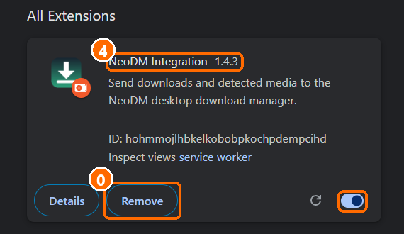
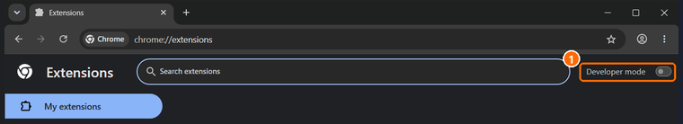
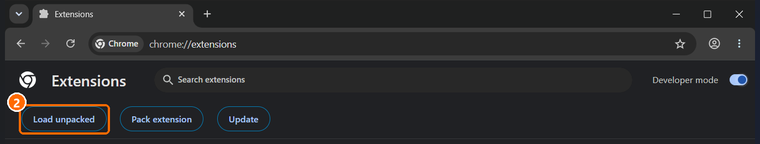
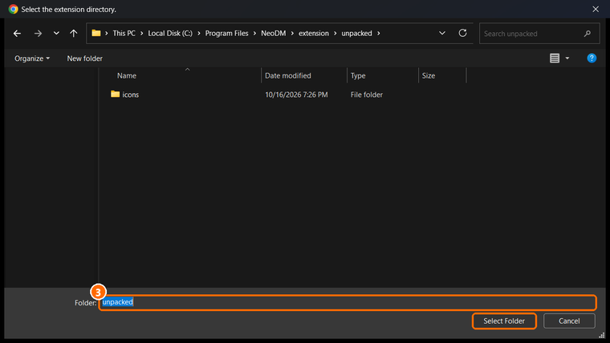

# Install the NeoDM browser extension

> NeoDM Integration has been submitted to the Chrome Web Store and is waiting for approval. Until it is approved, install it manually with Load unpacked, following the guide.

Once the extension is approved, it will install from the store and update by itself, and a manual install can then be removed.

NeoDM Integration is not in a browser store yet, and Chrome, Edge and Brave block extensions that are installed from a file outside their store. So the browser loads the extension from a folder. This takes about a minute and you do it once.

The same guide is in NeoDM under Help > Browser extension install guide. It opens the extensions page for you, shows the real folder on your PC and lets you copy it.

The screenshots are from Chrome. Edge and Brave use the same layout, so they apply to all three browsers.

| Browser | Extensions page |
|---|---|
| Chrome | `chrome://extensions` |
| Edge | `edge://extensions` |
| Brave | `brave://extensions` |

Paste the address into the address bar of the browser you use.

### Step 0. If you already installed NeoDM Integration, remove the old one first.

- Open the extensions page with the address above.
- Find NeoDM Integration.
- Click Remove and confirm.
- Two copies of the extension fight over the same downloads, and the browser keeps loading the folder it was first installed from.

### Step 1. Turn on Developer mode.

- Turn on Developer mode. In Chrome and Brave the toggle is at the top right of the page. In Edge it is on the left side of the page.

Per browser:

- Turn on Developer mode. In Chrome the toggle is at the top right of the page.
- Turn on Developer mode. In Edge the toggle is on the left side of the page.
- Turn on Developer mode. In Brave the toggle is at the top right of the page.

### Step 2. Click Load unpacked.

- The button appears after Developer mode is on.

### Step 3. Choose the NeoDM extension folder.

- Paste the path below into the folder picker, or browse to it, then click Select Folder.

With the installer the folder is `C:\Program Files\NeoDM\extension\unpacked` (or the install folder you chose, then `extension\unpacked`). NeoDM shows the exact path in the guide window, with Copy path and Open folder buttons. If NeoDM cannot find the folder, the guide says: The extension folder was not found. Reinstall NeoDM to restore it.

### Step 4. Check that NeoDM Integration shows version 1.4.4 and is switched on.

- Pin it from the puzzle piece menu in the toolbar.
- Open its popup and click Test connection. It should say Host connected.

The version number is the NeoDM version you installed. If the popup also shows a line such as "NeoDM app 1.4.3, extension 1.4.2", the browser still runs an older copy of the extension. Go back to step 0.

### Step 5. After a NeoDM update that changes the extension, install it again.

- Repeat step 0, then step 2. Or click the reload arrow on the NeoDM Integration card.
- Chrome and Edge show a notice about developer mode extensions each time the browser starts. Close it. The extension keeps working.

NeoDM tells you when the extension and the app differ. The capture window then shows a banner with a Show install guide button.

## If something goes wrong

**The browser blocks the extension and mentions its store.**
That is expected for a .crx file. Do not open the .crx. Use Load unpacked with the folder from step 3.

**Test connection says the host is unavailable.**
Install NeoDM with its setup program, which registers the browser connection. Then restart the browser and try again.

**The extension stopped working after I moved or deleted the folder.**
The browser remembers the folder path. Remove the extension and load the folder again from step 3.
